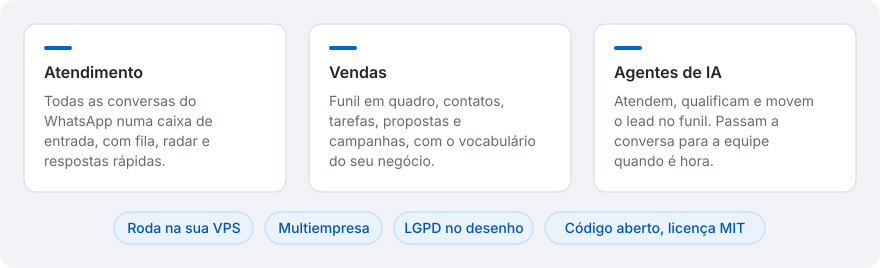
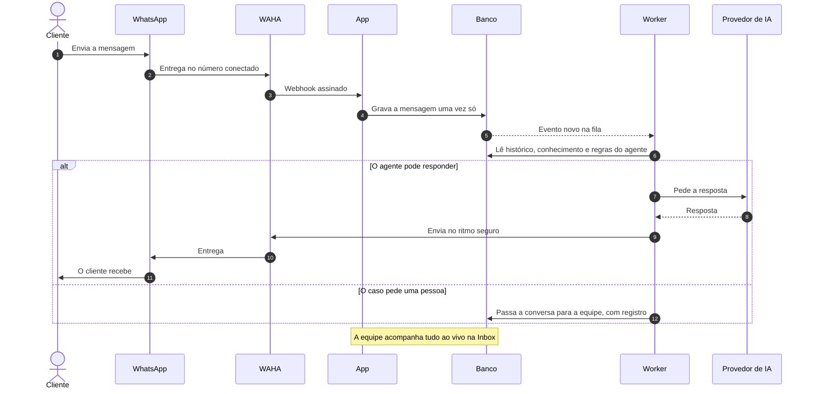
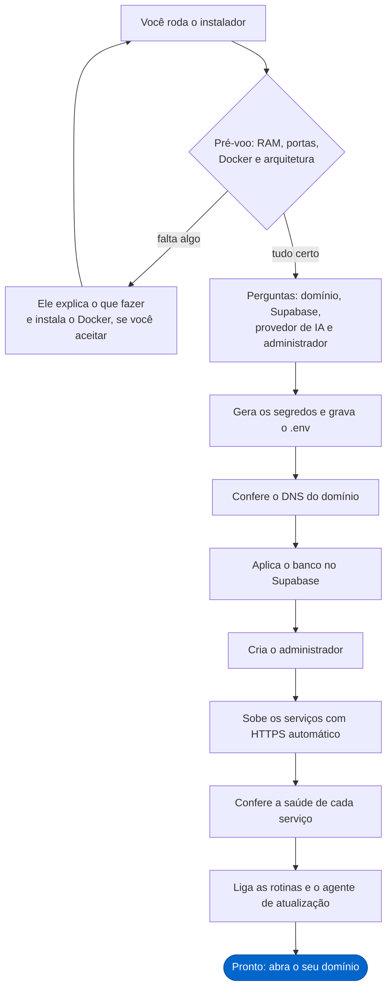
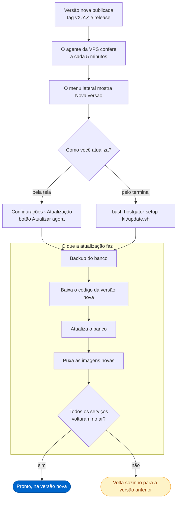
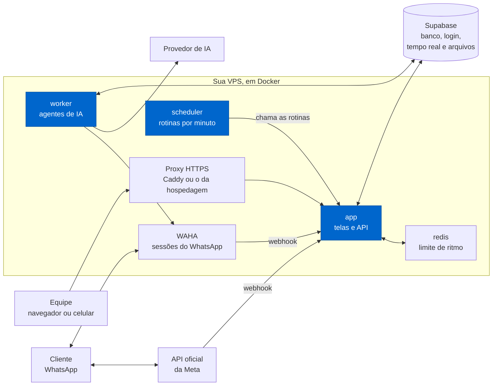

<picture>
  <source media="(prefers-color-scheme: dark)" srcset=".github/readme/capa-escuro.svg">
  
</picture>

[](LICENSE)


O Unnify CRM junta numa tela só o atendimento pelo WhatsApp, o funil de vendas e os agentes de IA.
Os agentes atendem, qualificam, movem o lead no funil e passam a conversa para uma pessoa quando é
hora. Faz parte da Unnify, ao lado do portal Unnify, do Unnify Pulse e do Unnify Work.

Você instala na sua VPS, com um comando. Os dados ficam com você. O código é aberto, sob a licença
MIT, e não existe versão paga nem funcionalidade travada.

<!--
  PRINTS DA INTERFACE
  Ainda não há prints da interface nova do Unnify, e os da interface antiga não entram aqui.
  Quando houver, salve as duas variantes em .github/readme/ e troque este comentário por:

  <picture>
    <source media="(prefers-color-scheme: dark)" srcset=".github/readme/print-inbox-escuro.png">
    
  </picture>
-->

## Sumário

- [O que é](#o-que-é)
- [Como uma mensagem vira resposta](#como-uma-mensagem-vira-resposta)
- [Funcionalidades](#funcionalidades)
- [WhatsApp: QR Code ou API oficial](#whatsapp-qr-code-ou-api-oficial)
- [Antes de instalar](#antes-de-instalar)
- [Instalar](#instalar)
- [Atualizar](#atualizar)
- [Como funciona por dentro](#como-funciona-por-dentro)
- [Perguntas frequentes](#perguntas-frequentes)
- [Responsabilidades e segurança](#responsabilidades-e-segurança)
- [Licença](#licença)

## O que é

<picture>
  <source media="(prefers-color-scheme: dark)" srcset=".github/readme/visao-geral-escuro.svg">
  
</picture>

Serve a qualquer negócio que vende conversando: lojas, clínicas, imobiliárias, infoprodutos,
agências e prestadores de serviço. O vocabulário muda por funil: o lead pode virar _Cliente_,
_Paciente_ ou _Comprador_.

É multiempresa: uma instalação atende várias organizações, e cada uma vê só os próprios dados.

## Como uma mensagem vira resposta

<picture>
  <source media="(prefers-color-scheme: dark)" srcset=".github/readme/fluxo-da-mensagem-escuro.svg">
  
</picture>

1. **O cliente escreve** no WhatsApp da empresa.
2. **O WAHA recebe.** Ele mantém a sessão do número conectado por QR Code. No canal oficial, quem
   recebe é a própria Meta.
3. **O app confere e grava.** O aviso chega por um webhook assinado. A mensagem é gravada uma vez
   só, mesmo que o aviso chegue repetido.
4. **O banco enfileira.** Gravar a mensagem cria um evento na fila, e a equipe já vê a conversa ao
   vivo na Inbox.
5. **O worker responde com a IA.** Ele lê o histórico, a base de conhecimento e as regras do agente,
   pede a resposta ao provedor de IA e confere antes de enviar.
6. **A resposta volta** pelo mesmo número, no ritmo seguro de envio. Se o caso pede uma pessoa, a
   conversa passa para a equipe, com registro.

<details>
<summary>Ver o diagrama de sequência</summary>



</details>

## Funcionalidades

<picture>
  <source media="(prefers-color-scheme: dark)" srcset=".github/readme/funil-escuro.svg">
  
</picture>

A coluna **Onde fica** mostra o caminho no menu lateral. As telas do grupo **Organização** também
aparecem em **Configurações**.

### Atendimento

| Funcionalidade              | O que faz                                                                             | Onde fica                                      |
| --------------------------- | ------------------------------------------------------------------------------------- | ---------------------------------------------- |
| Inbox                       | Todas as conversas dos números conectados, com o painel do contato ao lado.           | Atendimento › Inbox                            |
| Radar                       | Mostra o que corre risco de ficar sem resposta.                                       | Atendimento › Radar                            |
| Agenda                      | Marca horários pela agenda ou direto na conversa.                                     | Atendimento › Agenda                           |
| Respostas rápidas           | Textos prontos para a equipe usar nas conversas.                                      | Atendimento › Respostas rápidas                |
| Mensagens rápidas           | Lê e responde uma conversa sem sair da tela em que você está.                         | Botão **Mensagens**, no canto inferior direito |
| Distribuição de atendimento | Fila com rodízio, atribuição e transferência com registro.                            | Organização › Distribuição de atendimento      |
| Central de avisos           | Junta o que precisa de decisão humana, como a conversa que a IA passou para a equipe. | Agente de IA › Alertas                         |

Guia: [mensagens rápidas](docs/features/mensagens-rapidas.md).

### Vendas

| Funcionalidade      | O que faz                                                                         | Onde fica                              |
| ------------------- | --------------------------------------------------------------------------------- | -------------------------------------- |
| Funis               | Quadro com as etapas do seu processo, com nomes e vocabulário que você escolhe.   | CRM › Funis e CRM › Etapas do funil    |
| Contatos e empresas | Ficha de cada contato, pessoa e empresa, com a linha do tempo e as tags.          | CRM › Contatos, Pessoas e Empresas     |
| Tarefas             | Tarefas da equipe e planos com uma sequência de passos para aplicar a um negócio. | CRM › Tarefas e CRM › Planos de tarefa |
| Propostas           | Editor de propostas, com modelos.                                                 | CRM › Propostas                        |
| Campanhas           | Disparo para uma lista de contatos, no ritmo seguro de envio.                     | CRM › Campanhas                        |
| Prospecção          | Busca empresas por segmento e região e monta uma campanha de primeiro contato.    | CRM › Prospecção                       |
| Importações         | Traz empresas e pessoas de uma planilha CSV ou XLSX.                              | CRM › Importações                      |

Guia: [prospecção nativa](docs/features/prospeccao-nativa.md).

### Agentes de IA

| Funcionalidade           | O que faz                                                                                       | Onde fica                                      |
| ------------------------ | ----------------------------------------------------------------------------------------------- | ---------------------------------------------- |
| Agentes                  | Atendem, qualificam e movem o lead no funil, com as mesmas regras de uma pessoa.                | Agente de IA › Agentes                         |
| Roteadores               | Escolhem qual agente atende cada conversa, pela intenção do cliente.                            | Agente de IA › Roteadores                      |
| Conhecimento             | Base de conhecimento da organização, que o agente consulta para responder.                      | Agente de IA › Conhecimento                    |
| Memória e skills         | O que o agente aprendeu da operação e as habilidades que ele executa sozinho.                   | Agente de IA › Memória e Agente de IA › Skills |
| Casos                    | Perguntas que o agente faz à equipe quando não sabe a resposta.                                 | Agente de IA › Casos                           |
| Propostas da IA          | Melhorias que a própria IA sugere. Só entram com aprovação.                                     | Agente de IA › Propostas                       |
| Provedores e credenciais | OpenRouter, Anthropic, OpenAI, Google, DeepSeek, Requesty ou um provedor compatível com OpenAI. | Agente de IA › Provedores e Credenciais        |
| Uso e orçamento          | Mostra o gasto com IA e define um teto por organização.                                         | Agente de IA › Uso e orçamento                 |
| Execuções                | O registro de cada turno do agente, para conferir o que ele fez.                                | Agente de IA › Execuções                       |

Guia: [provedor personalizado](docs/features/provedor-personalizado.md).

### Automações

| Funcionalidade        | O que faz                                                                                               | Onde fica                            |
| --------------------- | ------------------------------------------------------------------------------------------------------- | ------------------------------------ |
| Follow-ups            | Retomam a conversa que esfriou, com tempo adaptativo e gatilhos por etapa do funil.                     | Agente de IA › Follow-ups            |
| Fluxos de atendimento | Roteiros desenhados em fluxo para o agente seguir.                                                      | Agente de IA › Fluxos de atendimento |
| Automações            | Regras QUANDO / SE / ENTÃO: pôr tag, mover no funil, atribuir, mandar mensagem ou avisar outro sistema. | Canais › Webhooks                    |
| Fontes de captação    | Um endereço que recebe leads de landing pages, formulários, Zapier ou n8n e já os põe no funil.         | Canais › Webhooks                    |
| Interruptores         | Liga e desliga as automações prontas do sistema.                                                        | Organização › Automações             |

Guia: [importar e exportar fluxos](docs/features/importar-exportar-fluxos.md).

### Relatórios

| Funcionalidade | O que faz                                                                 | Onde fica                    |
| -------------- | ------------------------------------------------------------------------- | ---------------------------- |
| Desempenho     | Atrito, funil e desempenho por atendente.                                 | Análise › Desempenho         |
| Atividades     | O que aconteceu na operação no período, e quanto disso foi a equipe.      | Análise › Atividades         |
| Evolução da IA | Mostra onde o agente erra.                                                | Análise › Evolução da IA     |
| Meta Ads       | A origem de cada lead em campanha, conjunto, anúncio e posicionamento.    | Análise › Meta Ads           |
| Meta de vendas | Quanto a empresa quer vender no mês; o Desempenho mostra o quanto já foi. | Organização › Meta de vendas |
| Audit Log      | Quem fez o quê, e quando, em toda mudança feita no sistema.               | Análise › Audit Log          |

Guia: [trackeamento de campanha](docs/features/trackeamento-de-campanha.md).

### Integrações

| Funcionalidade       | O que faz                                                                     | Onde fica                          |
| -------------------- | ----------------------------------------------------------------------------- | ---------------------------------- |
| WhatsApp             | Conecta números por QR Code ou pelo canal oficial da Meta.                    | Canais › Conexões                  |
| Nuvemshop            | Liga a loja ao CRM, com pedidos e produtos.                                   | Canais › Nuvemshop                 |
| Webhooks             | Recebe dados de outros sistemas e avisa outros sistemas quando algo acontece. | Canais › Webhooks                  |
| API e MCP            | API REST com tokens e o CRM exposto como ferramentas para agentes (MCP).      | Organização › API Tokens           |
| Servidor MCP externo | Deixa o agente usar ferramentas de um sistema seu, como um ERP.               | Organização › Servidor MCP externo |
| Dados externos       | Deixa o agente consultar um banco de dados seu, só no que você liberar.       | Organização › Dados externos       |
| Conversões           | Envia as conversões do funil para a Meta e o Google Ads.                      | Organização › Conversões           |
| Extensões            | Pacotes que acrescentam funções sem mexer no núcleo.                          | Organização › Extensões            |

## WhatsApp: QR Code ou API oficial

Você pode usar os dois canais ao mesmo tempo, em números diferentes. Os dois se conectam em
**Canais › Conexões**.

|                         | QR Code (WAHA)                                                 | API oficial (Meta)                                                 |
| ----------------------- | -------------------------------------------------------------- | ------------------------------------------------------------------ |
| **Como conecta**        | Você lê um QR Code com o celular, como no WhatsApp Web.        | Você liga uma conta do WhatsApp Business Platform, na Meta.        |
| **Custo por mensagem**  | Nenhum.                                                        | A Meta cobra pela tabela dela.                                     |
| **Risco de bloqueio**   | Existe: não é um canal oficial da Meta.                        | Baixo, se você seguir as regras da Meta.                           |
| **Vários números**      | Sim. Cada número é uma sessão, que usa cerca de 150 MB de RAM. | Sim.                                                               |
| **Iniciar conversa**    | Livre, dentro do ritmo seguro de envio.                        | Fora da janela de 24 horas, só com modelos aprovados pela Meta.    |
| **Modelos de mensagem** | Não precisa.                                                   | Aprovados na Meta e sincronizados no CRM.                          |
| **Bom para**            | Começar rápido, atendimento e volume moderado.                 | Volume alto, campanhas e quem não pode correr o risco de bloqueio. |

> [!WARNING]
> No QR Code, o número pode ser bloqueado pelo WhatsApp, sobretudo em disparo em massa e em número
> novo. O CRM reduz o risco com ritmo de envio, intervalo variável entre mensagens, janela de
> horário e detecção de pedido de descadastro. Ele não elimina o risco. Para volume alto, use a API
> oficial.

## Antes de instalar

| Item         | O que você precisa                                                                                     |
| ------------ | ------------------------------------------------------------------------------------------------------ |
| **VPS**      | Linux com acesso root, x86_64 ou ARM64. 2 vCPUs e 4 GB de RAM recomendados.                            |
| **Portas**   | 80 e 443 abertas. Se o servidor já tem um proxy nessas portas, o instalador usa o proxy que já existe. |
| **Docker**   | Se faltar, o instalador pergunta e instala.                                                            |
| **Domínio**  | Um registro **A** apontando para o IP da VPS (ex.: `crm.suaempresa.com.br`).                           |
| **Banco**    | Um projeto no [Supabase](https://supabase.com). O plano grátis serve para começar.                     |
| **IA**       | Uma chave de OpenRouter, Anthropic ou OpenAI. Pode ficar para depois.                                  |
| **WhatsApp** | O número da empresa, conectado por QR Code no primeiro acesso, ou o canal oficial da Meta.             |

> [!IMPORTANT]
> Com menos de 4 GB de RAM a instalação sobe, mas opera no limite: são sete contêineres, e cada
> número de WhatsApp conectado por QR Code usa mais memória. O instalador avisa quando a máquina é
> pequena demais.

> [!TIP]
> Não quer criar o projeto do Supabase à mão? Gere um token em
> [supabase.com/dashboard/account/tokens](https://supabase.com/dashboard/account/tokens) e exporte
> `SUPABASE_ACCESS_TOKEN` antes de rodar o instalador. Ele cria o projeto e preenche as chaves
> sozinho. O token não fica salvo no servidor.

## Instalar

<picture>
  <source media="(prefers-color-scheme: dark)" srcset=".github/readme/instalacao-escuro.svg">
  
</picture>

1. **Aponte o domínio.** Crie o registro **A** do domínio com o IP da VPS.
2. **Entre na VPS** por SSH.
3. **Baixe o código e rode o instalador:**

   ```bash
   git clone https://github.com/personaltraineracademy-cwb/crm.git
   cd crm
   bash hostgator-setup-kit/install.sh
   ```

4. **Responda às perguntas:** domínio, chaves do Supabase, provedor de IA e o e-mail e a senha do
   administrador.
5. **Abra `https://<seu-domínio>`**, entre com o administrador e conecte o WhatsApp.

Você não instala Node nem compila nada: as imagens já vêm prontas de
`ghcr.io/personaltraineracademy-cwb`. Rodar o instalador de novo não quebra nada; ele retoma de
onde parou.

### O que o instalador faz



<details>
<summary>Instalar sem perguntas</summary>

Copie o modelo de configuração, preencha e rode com `--yes`:

```bash
cp .env.hostgator.example .env
nano .env
bash hostgator-setup-kit/install.sh --yes
```

</details>

<details>
<summary>VPS que já tem proxy próprio (Hostinger, Coolify, Dokploy, CapRover)</summary>

Algumas hospedagens entregam a VPS com um Traefik já ocupando as portas 80 e 443. O instalador
detecta isso, grava `REVERSE_PROXY=traefik` no `.env` e publica o CRM através do proxy que já
existe. Não desligue o proxy da hospedagem para liberar as portas: isso quebra o painel dela.

Rodando o Compose à mão nessas instalações, use sempre os dois arquivos:

```bash
docker compose -f docker-compose.prod.yml -f docker-compose.traefik.yml --env-file .env up -d
```

</details>

<details>
<summary>Supabase na mesma VPS</summary>

Se preferir não usar o Supabase na nuvem, o kit instala o CRM e um Supabase próprio na mesma
máquina. A única pergunta é o domínio; os segredos e a conta inicial são gerados ali. Para esse
modo, 8 GB de RAM são recomendados.

```bash
bash hostgator-setup-kit/install-single-server.sh
```

</details>

## Atualizar

Cada versão é publicada neste repositório com uma tag `vX.Y.Z` e uma release. A atualização sempre
leva à versão publicada mais nova, nunca a um commit solto.



**Pela tela (recomendado)**

1. Quando há versão nova, o menu lateral mostra **Nova versão** para o dono do servidor.
2. Abra **Configurações › Atualização** e leia o que muda.
3. Clique em **Atualizar agora** e acompanhe cada fase na mesma tela.

**Pelo terminal**

1. Entre na VPS e vá para a pasta da instalação (`cd crm`).
2. Rode:

   ```bash
   bash hostgator-setup-kit/update.sh
   ```

3. Espere a conferência de saúde no fim.

> [!NOTE]
> O backup do banco é feito antes de qualquer mudança. Se a versão nova subir quebrada, a
> instalação volta sozinha para a anterior. O `update.sh` não volta para uma versão mais antiga sem
> `--force`.

Veja o que mudou em cada versão nas
[releases](https://github.com/personaltraineracademy-cwb/crm/releases).

<details>
<summary>Os scripts do kit</summary>

Todos ficam em `hostgator-setup-kit/` e rodam na pasta da instalação.

| Script                     | O que faz                                                     |
| -------------------------- | ------------------------------------------------------------- |
| `install.sh`               | Instala tudo. Pode rodar de novo.                             |
| `install-single-server.sh` | Instala o CRM com um Supabase próprio na mesma VPS.           |
| `update.sh`                | Atualiza para a versão nova, com backup antes.                |
| `backup.sh`                | Backup do banco e das sessões do WhatsApp.                    |
| `restore.sh`               | Restaura um backup num banco vazio.                           |
| `reset-password.sh`        | Redefine a senha de um usuário.                               |
| `reset-mfa.sh`             | Remove a verificação em duas etapas de quem perdeu o celular. |
| `healthcheck.sh`           | Diagnóstico de todos os serviços.                             |

</details>

## Como funciona por dentro



As peças em azul são as imagens do Unnify CRM. As outras são serviços conhecidos, usados como
vêm.

| Peça            | O que faz                                                                                 |
| --------------- | ----------------------------------------------------------------------------------------- |
| **app**         | As telas e a API. Recebe os webhooks do WhatsApp, confere a assinatura e grava no banco.  |
| **worker**      | Lê a fila de eventos e roda os agentes de IA: monta a resposta, confere e envia.          |
| **scheduler**   | Chama as rotinas agendadas: follow-ups, campanhas, lembretes, mensagens presas, retenção. |
| **WAHA**        | Mantém as sessões dos números conectados por QR Code.                                     |
| **redis**       | Guarda os contadores de limite de requisições, inclusive os da IA.                        |
| **Supabase**    | Postgres com isolamento por organização, login, tempo real e arquivos de mídia.           |
| **Proxy HTTPS** | Publica o CRM no seu domínio, com certificado automático.                                 |

Três ideias seguram o desenho:

- **Nada se perde no caminho.** Toda mensagem e todo evento são gravados antes de qualquer efeito.
  Quem faz o efeito é um worker, que pode tentar de novo sem duplicar.
- **Cada organização vê só o que é dela.** O isolamento mora no próprio banco, com regras por
  linha em toda tabela.
- **Nada é compilado na sua VPS.** As imagens são construídas e publicadas pelo CI, para x86_64 e
  ARM64. A VPS só baixa.

<details>
<summary>A stack completa</summary>

| Camada            | Escolha                                                          |
| ----------------- | ---------------------------------------------------------------- |
| **Frontend**      | Next.js 16 (App Router) + React 19 + TypeScript estrito          |
| **Estilo**        | Tailwind + shadcn/ui                                             |
| **Banco**         | Supabase (Postgres com RLS e `vector`)                           |
| **Auth**          | Supabase Auth via `@supabase/ssr`                                |
| **Realtime**      | Supabase Realtime                                                |
| **Storage**       | Supabase Storage, bucket privado com URLs assinadas              |
| **WhatsApp**      | WAHA (engine NOWEB) e Meta Cloud API                             |
| **Filas**         | Tabela `event_log` + workers                                     |
| **Rate limit**    | Redis                                                            |
| **IA**            | Vercel AI SDK: OpenRouter, Requesty, Anthropic, OpenAI e Google  |
| **Validação**     | Zod                                                              |
| **Observability** | Sentry, opcional, com CPF, telefone e e-mail mascarados no envio |
| **Hospedagem**    | Qualquer VPS com Docker, x86_64 ou ARM64                         |

</details>

## Perguntas frequentes

<details>
<summary><strong>Meu número pode ser bloqueado se eu usar o QR Code?</strong></summary>

Pode. A conexão por QR Code funciona como um aparelho a mais no número, igual ao WhatsApp Web, e não
é um canal oficial da Meta. O risco cresce com disparo em massa, número novo e mensagem para quem
não espera contato.

O CRM reduz o risco: limita o ritmo de envio, varia o intervalo entre mensagens, respeita uma
janela de horário e para de escrever para quem pede descadastro. Comece com volume baixo num número
novo. Para volume alto, use a [API oficial](#whatsapp-qr-code-ou-api-oficial).

</details>

<details>
<summary><strong>Quanto custa?</strong></summary>

O software é grátis, sem versão paga e sem funcionalidade travada. Você paga à parte só o que usa
de terceiros:

| Item                | Quem cobra                                                                         |
| ------------------- | ---------------------------------------------------------------------------------- |
| VPS e domínio       | A sua hospedagem e o seu registro de domínio.                                      |
| Supabase            | O Supabase. O plano grátis serve para começar; ele tem limites e não faz backup.   |
| IA                  | O provedor que você escolher, pelo consumo. Defina um teto em **Uso e orçamento**. |
| API oficial da Meta | A Meta, pela tabela dela. O QR Code não tem custo por mensagem.                    |

</details>

<details>
<summary><strong>Como faço backup?</strong></summary>

Rode o `backup.sh`, que guarda o banco e as sessões do WhatsApp:

```bash
bash hostgator-setup-kit/backup.sh
```

O plano grátis do Supabase não faz backup sozinho. Agende o `backup.sh` no cron da VPS e copie os
arquivos para fora dela. Para voltar um backup num banco vazio, use o `restore.sh`. A atualização
também faz um backup do banco antes de mudar qualquer coisa.

</details>

<details>
<summary><strong>E a LGPD?</strong></summary>

A LGPD faz parte do desenho:

- cada organização vê só os próprios dados, com o isolamento garantido no banco;
- a tela **Organização › LGPD** recebe os pedidos dos titulares, gera a exportação dos dados e
  anonimiza o contato, apagando a mídia das conversas;
- toda mudança fica no **Audit Log**;
- a telemetria de erros é opcional e mascara CPF, telefone e e-mail antes de sair.

Quem hospeda a instalação é o controlador dos dados tratados nela. Veja
[Responsabilidades e segurança](#responsabilidades-e-segurança).

</details>

<details>
<summary><strong>Dá para usar vários números?</strong></summary>

Dá. Conecte quantos números quiser em **Canais › Conexões**, por QR Code, pela API oficial ou pelos
dois. Os **Roteadores** escolhem qual agente atende cada número, e a **Distribuição de atendimento**
reparte as conversas entre as pessoas da equipe. Lembre que cada número por QR Code usa cerca de
150 MB de RAM na VPS.

</details>

<details>
<summary><strong>Preciso saber programar?</strong></summary>

Não. O instalador faz as perguntas, confere cada resposta e sobe tudo. Você precisa saber entrar
na VPS por SSH, colar os comandos desta página e apontar o domínio para o IP do servidor.

</details>

<details>
<summary><strong>Posso trocar o provedor de IA depois?</strong></summary>

Pode. O provedor escolhido na instalação é só o ponto de partida. Em **Agente de IA › Credenciais**
você cadastra outras chaves e escolhe o provedor por parte do sistema.

</details>

## Responsabilidades e segurança

Cada instalação roda na infraestrutura de quem a hospeda: VPS, banco e chave de IA próprios. Quem
hospeda é o **controlador** dos dados pessoais tratados ali, com as obrigações da LGPD.

A telemetria de erros (Sentry) é perguntada na instalação e pode ser desligada a qualquer momento
com `SENTRY_DSN=off` no `.env`.

Para falhas de segurança, veja [`SECURITY.md`](SECURITY.md). Para dúvidas e bugs, veja
[`CONTRIBUTING.md`](CONTRIBUTING.md).

## Licença

O Unnify CRM é distribuído sob a licença **MIT**. Veja [`LICENSE`](LICENSE).

Ele é derivado de um projeto de código aberto sob a mesma licença. Os avisos de copyright de
todos os autores estão no `LICENSE` e precisam acompanhar qualquer cópia ou parte substancial
do código. O software é fornecido "como está", sem garantias.
